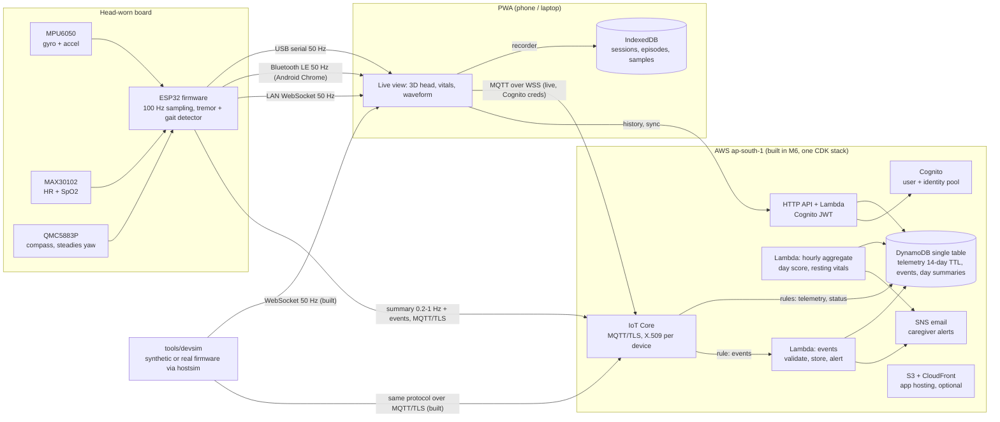

# Architecture

Status after milestone 9: accessibility audit (axe on every screen, focus trap in dialogs), UI pass, demo script. Status after milestone 8: the compass (QMC5883P) steadies the yaw. Status after milestone 7: the firmware streams over **Bluetooth LE** and a LAN **WebSocket** as well as USB, reports to AWS IoT over MQTT, and the app can install on a phone, connect over Bluetooth, set up the headset's Wi-Fi, sign in to the cloud, watch a headset remotely, show history and sync. Status after milestone 6: the **AWS backend** is built as one CDK stack in `ap-south-1` (IoT Core with per-device X.509 certificates, IoT rules into DynamoDB, events/aggregate/API Lambdas, HTTP API with Cognito JWT, Cognito user and identity pools, SNS caregiver email, budget, optional S3 + CloudFront hosting), with device provisioning scripts, a kill switch, and the simulator publishing the v1 cloud protocol over MQTT/TLS. The firmware networking and the app's sign-in and live cloud view follow in milestone 7. Status after milestone 5: doctor report PDF generated in the browser (jsPDF, lazily loaded; vector charts). Status after milestone 4: medication schedules, reminders and dose log; quick tags; Insights with time-of-day-matched tag comparisons, paired before/after medication comparisons, heart rate around episodes (bootstrap intervals, Bonferroni-corrected, "not enough data" thresholds), and pattern hints from a reviewable table. Status after milestone 3: firmware reports every shaking axis and per-line acceleration extremes with a ±8 g range; the app adds combined-tremor analysis, fall candidates with a cancel countdown, posture and stillness against a calibrated neutral pose, and resting vitals. Status after milestone 2: the **local path** is built: firmware (unchanged legacy sketch), USB / WebSocket / demo / replay transports, the live view, and local history (sessions, scored episodes, 1 Hz samples in IndexedDB) with Trends. Everything shown dashed below is planned.



## Decisions so far

| Decision | Why |
|---|---|
| The phone gets the local 50 Hz stream over **Bluetooth LE (Web Bluetooth)** | The demo phone is Android. Chrome there supports Web Bluetooth. An HTTPS-hosted app can't open plain `ws://` connections to the ESP32 on the LAN (mixed content), and a self-signed `wss://` server would use much of the ESP32's memory. |
| LAN WebSocket is kept for laptops and the simulator | Works from `http://localhost` and from an `http://` origin on the LAN. Useful for development and as a stage fallback. |
| **Host simulator compiles the real sketch** (`tools/hostsim`) | Detector and range changes are regression-tested against the actual firmware code, not a re-implementation. The simulated MPU6050 reads its range registers, so ±2 g saturation shows up automatically. |
| Live data stays outside React (`app/src/device/live.ts`) | 50 frames/s go into ring buffers. The canvas and 3D views read them every animation frame; React re-renders at 10 Hz. |
| Quaternions for the 3D head (`app/src/logic/orientation.ts`) | No gimbal-lock artefacts. Shortest-path slerp with frame-rate-independent smoothing. |
| Sessions and episodes are derived in the app, not the firmware | The firmware already streams the alert flag and band statistics. Deriving episodes in pure, tested TypeScript keeps the device simple and lets the cloud Lambda (M6) reuse the same rules. |
| Demo, replay and sample data are stored but flagged `demo` | The stage demo can show history, and real data can always be separated from it. |
| Fall, posture and resting-vitals rules run in the app for now | They are pure, tested TypeScript run on the firmware's output (host-simulator fixtures). The firmware sends the 100 Hz information they need (`aMax`, `aMin`). A firmware port of the fall rule is planned with networking (milestone 7), so a fall can raise a cloud event without the phone. |
| The firmware reports WHICH axes shake, the app works out HOW they move together | Keeps the device's alert logic unchanged and regression-identical. Phase relations need only the 50 Hz band-passed signals the firmware already streams. |
| Procedural head model | No licensing questions, about 0 KB of model download, and exactly the requested look (neutral skin, hair, glasses, headband with the sensor pod). See `HEAD_MODEL.md`. |
| Phone link is **Bluetooth LE**, the cloud link is Wi-Fi + MQTT, both run in one FreeRTOS task on core 0 | The 100 Hz detector on core 1 only copies a frame into a queue; a slow phone, a bad Wi-Fi link or a TLS handshake cannot make it miss a sample. |
| The firmware computes cloud summaries itself (C++ port of the app's tracker, severity and fall rules) | A headset on Wi-Fi works with no phone nearby, and falls reach the caregiver without the app. `hostsim:cloud` proves the port gives the same messages as the TypeScript reference. |
| Compass only touches yaw, as a slow correction (5 s) with gates | A magnet or steel nearby can never affect tremor detection, and a 5 Hz tremor averages out of the correction. Tested for both. |
| The cloud client loads lazily | Initial JS stays about 103 KB gzip; the cloud screens and the MQTT library (99 KB gzip) load only for people who set the cloud up. |
| App setup by link (`tools/aws/app-link.mjs`), validated to AWS hosts | A static site has no server to hold configuration, and a crafted link must not be able to redirect the sign-in. |
| CDK (TypeScript) for AWS, `ap-south-1` | One language across the repo; one command to deploy and to destroy. Mumbai is closest to the user, and IoT Core and Cognito user and identity pools are listed there (checked 2026-10-20, `COSTS.md`). |
| IoT rule writes telemetry straight to DynamoDB; Lambda only for events and an hourly aggregate | No Lambda run per telemetry message. The aggregator overwrites whole hour buckets, so it is idempotent. |
| Topics carry the owner: `tremor/v1/{owner}/{thing}/…` | The device policy reads the owner from the thing attribute, and the browser policy from the Cognito identity, so neither can publish or read under another user, with no wildcard grants. |
| Browser live view by **MQTT over WSS with identity-pool credentials** (rather than API Gateway WebSockets) | No server code on the live path, the broker fans out, and credentials are temporary (1 h) and scoped to the user's own topic prefix. The API links a signed-in user to their identity and attaches the IoT policy after checking the identity with Cognito. |
| Adaptive rate: 0.2 Hz, 1 Hz only while a retained `viewer` flag with an expiry is set | Typical cost about $0.35 a month (`COSTS.md`); a forgotten tab can't keep the rate high. |
| Provisioned DynamoDB 10/15 | The always-free allowance covers provisioned capacity only; demand is far below it. |
| One protocol module shared by simulator, Lambdas and app (`logic/protocol.ts`) | The schemas, the rule mirror in the tests, and the docs can't drift apart. The aggregator imports the app's severity formula, so cloud and phone scores match. |

## Code map

```
app/src/logic/      pure, unit-tested: csv.ts (protocol), orientation.ts, demoGen.ts, severity.ts,
                    tracker.ts (sessions/episodes/samples/vitals/falls), daily.ts, sampleHistory.ts, recording.ts,
                    multiaxis.ts (combined tremor), fall.ts, posture.ts, vitals.ts, meds.ts, correlate.ts, stats.ts,
                    hints.ts; __fixtures__ = firmware output
app/src/config/      thresholds.ts (every threshold, commented), hints.ts (pattern hint table, needs clinical review)
app/src/data/       db.ts (IndexedDB), recorder.ts (live stream -> storage), csvExport.ts
app/src/device/     sources.ts (Web Serial, Web Bluetooth, WebSocket, demo, replay), live.ts (live state, commands)
app/src/components/ Head3D + headModel (three.js), Circle2D, Traces, ConnectSheet, TabBar
app/src/screens/    Live, Trends, Log, Insights, Report, Settings, About
app/src/report/     pdf.ts (doctor report layout); logic/reportData.ts assembles its content
app/src/cloud/      config (validated setup), auth (Cognito PKCE), aws (identity + API clients), sigv4, liveSource (MQTT over WSS), sync, client (store)
app/src/theme/      tokens.css: every colour, font, size, radius in one place
tools/hostsim/      mock Arduino + synthetic sensors; run.mjs = regression runner
tools/devsim/       50 Hz stream over WebSocket / stdout; --mqtt publishes the v1 cloud protocol (mqtt.ts); cloudmock.ts = local stand-in for the whole AWS backend
tools/aws/          provision-device, deprovision-device, killswitch, cloud-e2e (use your AWS CLI login)
infra/              CDK app: lib/stack.ts (the stack), lambda/ (events, aggregate, api, shared), test/ (template + local cloud path)
app/src/logic/protocol.ts, cloudSummary.ts   cloud protocol v1 and the 50 Hz -> summary/events reducer
firmware/           tremor_monitor: detector + axes mask + |a| extremes (±8 g), frame.h, reporter.h (cloud summaries), mag.h (compass), link.h (BLE, WebSocket, Wi-Fi, MQTT)
```
