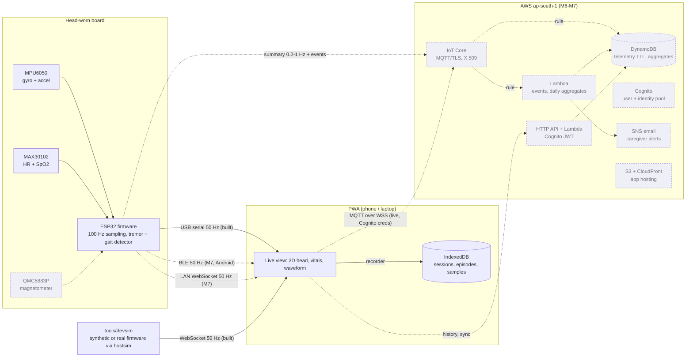

# Architecture

Status after milestone 2: the **local path** is built: firmware (unchanged legacy sketch), USB / WebSocket / demo / replay transports, the live view, and local history (sessions, scored episodes, 1 Hz samples in IndexedDB) with Trends. Everything shown dashed below is planned.



## Decisions so far

| Decision | Why |
|---|---|
| The phone gets the local 50 Hz stream over **Bluetooth LE (Web Bluetooth)** | The demo phone is Android. Chrome there supports Web Bluetooth. An HTTPS-hosted app can't open plain `ws://` connections to the ESP32 on the LAN (mixed content), and a self-signed `wss://` server would use much of the ESP32's memory. |
| LAN WebSocket is kept for laptops and the simulator | Works from `http://localhost` and from an `http://` origin on the LAN. Useful for development and as a stage fallback. |
| **Host simulator compiles the real sketch** (`tools/hostsim`) | Detector and range changes are regression-tested against the actual firmware code, not a re-implementation. The simulated MPU6050 reads its range registers, so ±2 g saturation shows up automatically. |
| Live data stays outside React (`app/src/device/live.ts`) | 50 frames/s go into ring buffers. The canvas and 3D views read them every animation frame; React re-renders at 10 Hz. |
| Quaternions for the 3D head (`app/src/logic/orientation.ts`) | No gimbal-lock artefacts. Shortest-path slerp with frame-rate-independent smoothing. |
| Sessions and episodes are derived in the app, not the firmware | The firmware already streams the alert flag and band statistics. Deriving episodes in pure, tested TypeScript keeps the device simple and lets the cloud Lambda (M6) reuse the same rules. |
| Demo, replay and sample data are stored but flagged `demo` | The stage demo can show history, and real data can always be separated from it. |
| Procedural head model | No licensing questions, about 0 KB of model download, and exactly the requested look (neutral skin, hair, glasses, headband with the sensor pod). See `HEAD_MODEL.md`. |
| CDK (TypeScript) for AWS, `ap-south-1` | Planned for milestone 6: one language across the repo; region closest to the user. Service availability will be verified then. |

## Code map

```
app/src/logic/      pure, unit-tested: csv.ts (protocol), orientation.ts, demoGen.ts, severity.ts,
                    tracker.ts (sessions/episodes/samples), daily.ts, sampleHistory.ts, recording.ts
app/src/data/       db.ts (IndexedDB), recorder.ts (live stream -> storage), csvExport.ts
app/src/device/     sources.ts (Web Serial, WebSocket, BLE stub, demo), live.ts (live state)
app/src/components/ Head3D + headModel (three.js), Circle2D, Traces, ConnectSheet, TabBar
app/src/screens/    Live, Trends, Settings (built); placeholders for Log / Insights / Report
app/src/theme/      tokens.css: every colour, font, size, radius in one place
tools/hostsim/      mock Arduino + synthetic sensors; run.mjs = regression runner
tools/devsim/       50 Hz stream over WebSocket / stdout (MQTT in M6)
firmware/           tremor_monitor (currently identical to legacy/tremor_stream.ino)
```
